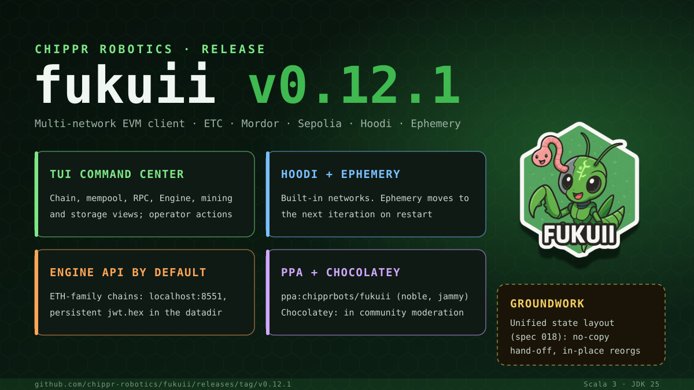

# fukuii 0.12.1: a command center, two new networks, and the ground under the next release

0.12.1 covers everything merged since 0.11.0, more than 130 changes. Some of it you can use today. Most of the
engineering went into a storage change that is not switched on yet, and is the reason the next release can do
things this one cannot.

<!-- more -->

## What you can use today

**The TUI command center.** Start the node with `--tui` and you get a full terminal dashboard. It has views for the
chain (with an explorer and a peer radar), the mempool, RPC, the Engine API, mining, storage and the host system. It
shows health bars, raises alerts at thresholds you can configure, and lets you act on the node from the same screen
([spec 029](https://github.com/chippr-robotics/fukuii/blob/main/specs/029-tui-command-center/spec.md)).

**Hoodi and Ephemery are built in.** Run `fukuii hoodi` or `fukuii ephemery`. Ephemery resets every 28 days. At a
reset the node exits with code 75, and when it is restarted it fetches and selects the next iteration by itself, so run
it under a supervisor such as systemd with `Restart=on-failure` (see the
[Ephemery runbook](../../runbooks/ephemery.md))
([spec 028](https://github.com/chippr-robotics/fukuii/blob/main/specs/028-builtin-ephemery-hoodi/spec.md)).

**The Engine API works out of the box.** On the chains that need a consensus client (Ethereum mainnet, Sepolia,
Hoodi, Ephemery, Platåberget) the Engine API now listens on `localhost:8551` by default. At first start fukuii
creates a persistent secret at `<datadir>/jwt.hex`, so you can point your consensus client's `--execution-jwt` at it.
ETC and Mordor are unchanged.

**New ways to install.** Releases are published to `ppa:chipprbots/fukuii` for Ubuntu noble and jammy. For Windows,
the `fukuii` package has been submitted to the Chocolatey community repository. It has passed the automated checks and
is waiting for a community moderator, so it is not listed yet.

## Correctness and hardening

- `eth_simulateV1`, VM error messages, precompile failures and the execution-apis fork-boundary and `eth_getProof`
  fixtures now answer the way go-ethereum does.
- EIP-1459 DNS discovery verifies the whole tree: root signature, entry hashes, ENR signatures and links.
- RPC namespaces are set per transport, with go-ethereum's defaults. WebSocket checks an Origin allowlist, malformed
  JWTs get a 401, and TLS uses a certificate generated for each deployment instead of a shipped sample.
- On post-merge chains the SNAP pivot is the consensus-layer head or one of its ancestors. Stored total difficulty is
  made exact once, and pruning deletes a trie node only when its reference counts are proven exact.
- On ETC, the miner builds exactly the block that block import computes.

## The ground under the next release

Most of this cycle went into Track C of
[spec 018](https://github.com/chippr-robotics/fukuii/blob/main/specs/018-storage-engine-consolidation/spec.md): one
unified, position-keyed state layout for both ETC and ETH, replacing the separate Hash and Path schemes. With it:

- recent blocks' state is kept in forward layers beside the disk, and a reverse changeset index reads the state of a
  block behind the head or on a fork;
- a heavier branch is executed on pinned layers and adopted in one move, so a reorg happens in place;
- SNAP sync hands off to regular sync in one synced write, with nothing copied;
- a node can tell when it cannot follow the chain with the state it holds, and recover from it.

In 0.12.1 this sits behind a development guard that is off by default, so it does not change how your node runs
today. When the last slices land the guard is removed, and fukuii is left with one state layout.

## Get it

Download the JAR, zip or tarball (JDK 25+) from the
[v0.12.1 release](https://github.com/chippr-robotics/fukuii/releases/tag/v0.12.1), and verify them with
`SHA256SUMS.txt`.
